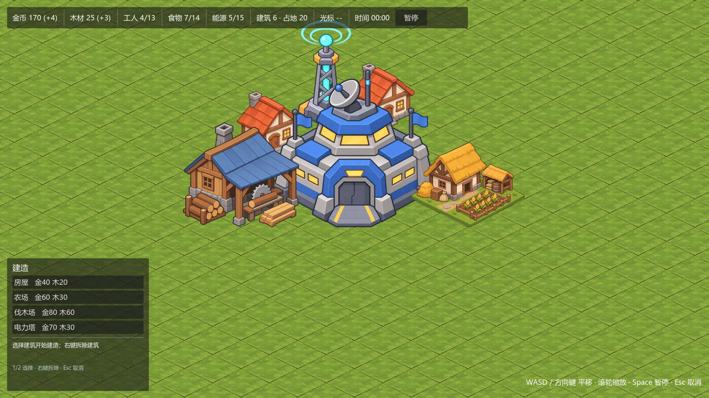

# Billions Mech｜区域指挥型生存 RTS

以《亿万僵尸》式基地经济为起点、后续叠加区块指挥视图的 2D 等距 RTS 原型。



- 设计文档：[区域指挥型生存RTS_设计文档_v0.2.md](区域指挥型生存RTS_设计文档_v0.2.md)
- 开发指南：[区域指挥生存RTS_基础开发指南_v0.1.md](区域指挥生存RTS_基础开发指南_v0.1.md)
- 当前阶段：**M1-04 资源与基础经济完成**，下一步 M1-05 建设范围与体验。

## 环境

| 项 | 值 |
|---|---|
| 引擎 | Godot 4.7.2 stable（Steam 版，`godot` 命令已在 PATH） |
| 语言 | GDScript |
| 渲染 | GL Compatibility |
| 视口 | 1600 × 900，`canvas_items` 缩放 |
| 地图 | 32 × 32 逻辑格，等距菱形 128 × 64 |
| 经济 tick | 1.0 游戏秒（可调 `GameState.economy_tick_seconds`） |

运行：双击 [run.bat](run.bat)，或命令行：

```powershell
godot --path .                      # 运行主场景
godot --headless --path . --import  # 只导入资源
godot --headless --path . --quit-after 90   # 冒烟校验（无渲染）
```

## 操作

| 操作 | 效果 |
|---|---|
| `WASD` / 方向键 | 平移镜头 |
| 鼠标滚轮 | 缩放（0.45×–3×） |
| `1`–`4` 或点击建造菜单 | 选择房屋 / 农场 / 伐木场 / 电力中继塔 |
| 左键 | 放置（保持选中，可连续建造） |
| 右键 / `Esc` | 取消当前建造 |
| 右键（未选建筑时） | 拆除光标下建筑，不返还资源 |
| `Space` | 暂停 / 继续 |

## 建筑

| 建筑 | 占地 | 成本 | 效果 |
|---|---|---|---|
| 指挥中心 | 3×3 | 开局自动放置 | +5 工人容量、+4 食物、+5 能源、+2 金币/tick；不可拆除、全局唯一 |
| 房屋 | 1×1 | 金 40 / 木 20 | +4 工人容量、+2 金币/tick；食物 2、能源 1 |
| 农场 | 2×2 | 金 60 / 木 30 | +10 食物供给；占 2 工人、能源 1 |
| 伐木场 | 2×2 | 金 80 / 木 60 | +3 木材/tick；占 2 工人、食物 1、能源 1、维护 1 金 |
| 电力中继塔 | 1×1 | 金 70 / 木 30 | +10 能源供给；维护 1 金；扩大建造范围（M1-05 生效） |

初始资源：金币 500、木材 200。

## 经济规则（M1-04）

1. **tick 固定 1 游戏秒。** `SimulationClock` 累加 `delta × speed`，每满 `tick_seconds` 发一次 `tick`；
   `EconomySystem` 在 `GameState` 的 tick 回调里统一结算所有建筑的产出与维护费。
   - 暂停时 `_process` 直接返回，不结算。
   - 单帧最多补算 5 个 tick，防止断点/拖窗口后一次性刷资源。
   - 倍速只影响累加速度，不改变每个 tick 的数值（M1-05 接入 UI）。
2. **库存与容量分开。** 金币/木材是库存；工人/食物/能源是“占用/供给”容量。
3. **建造前置校验按“建成后”的总量判断**，包含新建筑自身的供给：
   ```text
   workers_used + new.required   <= workers_total + new.housing
   food_demand  + new.food_demand<= food_supply   + new.food_capacity
   energy_demand+ new.energy_demand <= energy_supply + new.energy_supply
   ```
   任一不满足就不能落地，提示具体缺多少；资源检查在容量检查之后，失败不扣费。
4. **拆除不返还资源。** 拆除后重新全量计算容量与每 tick 收支；指挥中心不可拆除。
5. **赤字只阻止新增需求。** 拆除农场导致食物赤字时，UI 标红，新房屋被拒绝；
   补建农场（增加供给）仍然允许，避免死锁。

## 目录结构

```text
res://
  run.bat
  project.godot
  scenes/
    main.tscn                 # GameState + World + Camera2D + HUD + BuildController
    world.tscn                # Ground/Highlight/Decorations/Buildings/BuildPreview/RegionOverlay
    ui/hud.tscn               # 资源栏、建造菜单、区块面板占位
    world/build_preview.tscn
    buildings/building_view.tscn
  scripts/
    main.gd
    core/                     # game_state / grid_state / simulation_clock
    economy/economy_system.gd # 库存、容量、每 tick 收支、净变化
    buildings/                # definition / instance / system / view
    input/build_controller.gd
    ui/                       # hud / resource_panel / build_palette
    world/                    # world / cell_highlight / camera_controller / build_preview
    regions/region_system.gd  # M2 区块划分
  data/buildings/
    command_center.tres       # 3×3，初始核心
    house.tres                # 1×1
    farm.tres                 # 2×2
    lumberyard.tres           # 2×2
    power_tower.tres          # 1×1，能源 + 扩建
  tiles/terrain_tileset.tres
  art/placeholder/
    iso_ground.png
    buildings/{command_center,house,farm,lumberyard,power_tower}.png
  docs/screenshots/
  ui/fonts/system_cjk_font.tres
  临时素材/
```

## 架构约定

```text
GameState（唯一真实状态）
├── SimulationClock   固定 tick，驱动经济结算
├── GridState         逻辑格、占地、地形阻挡
├── EconomySystem     库存 + 容量 + 每 tick 收支
├── BuildingSystem    定义、实例、校验、建造/拆除
└── RegionSystem      区块划分（M2）

视图层：World / Camera2D / HUD / BuildController
  只读 GameState，接收信号；输入只调用 BuildingSystem 的公开接口
```

必须遵守：

1. **二维逻辑网格是唯一空间真相。** 占地只看 `origin_cell + footprint`，不看贴图尺寸。
2. **数据先于表现。** 先写 `GridState` / `instances` 并发信号，`World` 才创建/销毁 `BuildingView`。
3. **统一命令入口。** 手动建造与未来规划层都调用 `try_place_building()` / `remove_building()`；
   预览调用只读的 `get_placement_error()`，共用同一套规则。
4. **经济按模拟时间结算。** 收益只从 `SimulationClock.tick` 进入 `EconomySystem.process_tick()`。
5. **容量与库存分开。** 金/木是库存；工人/食物/能源是供给与占用。
6. **区块不产生经济。** M2 的统计必须从建筑实例聚合。

## 等距坐标与建筑锚点

- `TileSet`：**Isometric / 128×64 / `tile_layout = 5`**。默认 stacked 会得到横向条带坐标，必须显式设为 5。
- `map_to_local()` 返回格中心；32×32 地图世界范围约 `(-1984, -32) ~ (2112, 2080)`。
- 建筑占地块的前角（最下方顶点）：
  ```text
  anchor = cell_to_world(origin + footprint - 1) + (0, 32)
  ```
  贴图以底边中点对齐 anchor，节点 y 用于 Y 排序。
- 预览占地菱形：bottom `(0,0)`、right `(sy*64, -sy*32)`、top `((sy-sx)*64, -(sx+sy)*32)`、
  left `(-sx*64, -sx*32)`。

## 美术管线

`临时素材/*.png`（1254×1254，透明背景）→ 裁切 alpha 包围盒 → 按占地底宽缩放：

| 资产 | 底宽对应 | 游戏内尺寸 |
|---|---|---|
| 地块 | 1 格 | 128×64 |
| 房屋 | 1 格 | 145×148 |
| 伐木场 | 2 格 | 262×237 |
| 农场 | 2 格 | 256×192 |
| 电力中继塔 | 1 格 | 128×245 |
| 指挥中心 | 3 格 | 384×357 |

## 新增建筑

在 `data/buildings/` 新建 `BuildingDefinition` 资源，必填 `building_id`、`display_name`、`footprint`、`texture`：

- 菜单与规则：`buildable`、`unique`、`demolishable`、`palette_order`
- 成本与收支：`build_cost`、`upkeep_per_tick`、`output_per_tick`
- 容量：`housing_capacity`、`required_workers`、`food_capacity`、`food_demand`、
  `energy_supply`、`energy_demand`
- 范围：`build_range_radius`（M1-05）
- 视觉：`sprite_scale`、`sprite_offset`

`BuildingSystem` 启动时扫描该目录；建造菜单与 `1–4` 热键只列出 `buildable = true` 的定义。

## 已完成 / 下一步

M1-01（已完成）：项目骨架、GameState、场景、输入、Git。

M1-02（已完成）：等距 TileSet、32×32 地面、镜头平移/缩放/边界、悬停高亮与坐标。

M1-03（已完成）：1×1/2×2 建筑、预览与占地菱形、放置/取消/拆除、边界与重叠校验、Y 排序。

M1-04（已完成）：

- [x] 指挥中心开局自动放置（3×3，不可拆）
- [x] 五类建筑数据：指挥中心、房屋、农场、伐木场、电力中继塔
- [x] 资源栏显示库存、净变化 `(+N)`、工人/食物/能源占用与供给
- [x] 建造前校验容量与成本，失败不扣费、不占格
- [x] 每 tick 结算产出与维护费；净变化由建筑定义汇总
- [x] 拆除后产出停止、容量回退；赤字标红并阻止新增需求
- [x] 实测：食物满时拒绝房屋；拆农场后食物赤字；补建农场恢复；指挥中心拒绝拆除

M1-05（下一步）：

- [ ] 指挥中心/中继塔的建造覆盖范围与半透明覆盖层
- [ ] 范围外禁止建造
- [ ] 建筑信息面板（名称、成本、产出、占地）
- [ ] 暂停与倍速 UI（1×/2×/3×），结算仍按游戏时间

## 约定

- 脚本用 **Tab** 缩进；类名与文件名一致。
- 节点/资源 ID 用 `StringName`；资源键用 `String`（`"gold"`、`"wood"`）。
- 不写测试脚本；改动用 `godot --headless --path . --quit-after 90` 验证无报错。
- 提交前确认 `git status` 不含 `.godot/`。
