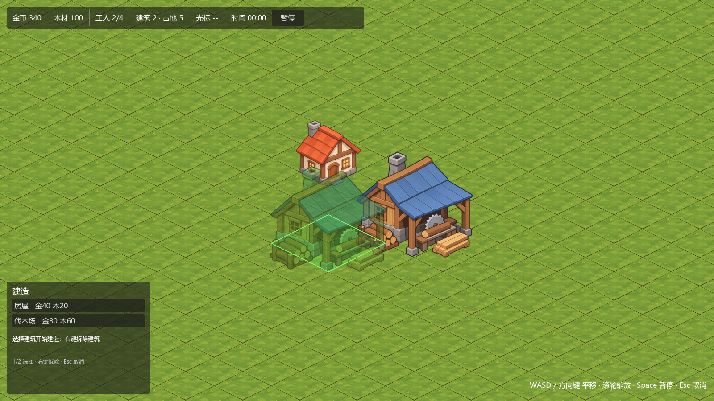

# Billions Mech｜区域指挥型生存 RTS

以《亿万僵尸》式基地经济为起点、后续叠加区块指挥视图的 2D 等距 RTS 原型。



- 设计文档：[区域指挥型生存RTS_设计文档_v0.2.md](区域指挥型生存RTS_设计文档_v0.2.md)
- 开发指南：[区域指挥生存RTS_基础开发指南_v0.1.md](区域指挥生存RTS_基础开发指南_v0.1.md)
- 当前阶段：**M1-03 建筑放置完成**，下一步 M1-04 资源与经济。

## 环境

| 项 | 值 |
|---|---|
| 引擎 | Godot 4.7.2 stable（Steam 版，`godot` 命令已在 PATH） |
| 语言 | GDScript |
| 渲染 | GL Compatibility |
| 视口 | 1600 × 900，`canvas_items` 缩放 |
| 地图 | 32 × 32 逻辑格，等距菱形 128 × 64 |
| 经济 tick | 1.0 游戏秒 |

运行：双击 [run.bat](run.bat)，或命令行：

```powershell
godot --path .                      # 运行主场景
godot --headless --path . --import  # 只导入资源
godot --headless --path . --quit-after 90   # 冒烟校验（无渲染）
```

## 操作

| 操作 | 效果 |
|---|---|
| `WASD` / 方向键 | 平移镜头 |
| 鼠标滚轮 | 缩放（0.45×–3×） |
| `1` / `2` 或点击建造菜单 | 选择房屋 / 伐木场 |
| 左键 | 放置（保持选中，可连续建造） |
| 右键 / `Esc` | 取消当前建造 |
| 右键（未选建筑时） | 拆除光标下建筑，不返还资源 |
| `Space` | 暂停 / 继续 |

## 目录结构

```text
res://
  run.bat                     # 双击启动（透传参数给 godot）
  project.godot
  scenes/
    main.tscn                 # GameState + World + Camera2D + HUD + BuildController
    world.tscn                # Ground/Highlight/Decorations/Buildings/BuildPreview/RegionOverlay
    ui/hud.tscn               # 资源栏、建造菜单、区块面板占位
    world/build_preview.tscn  # 建造预览（贴图 + 占地菱形）
    buildings/building_view.tscn
  scripts/
    main.gd
    core/                     # game_state / grid_state / simulation_clock
    economy/economy_system.gd
    buildings/
      building_definition.gd  # 静态定义（.tres）
      building_instance.gd    # 运行时实例（纯数据）
      building_system.gd      # 校验、扣费、占格、拆除
      building_view.gd        # 单栋建筑视觉
    input/build_controller.gd # 建造输入：选型/预览/放置/拆除
    ui/
      hud.gd
      resource_panel.gd
      build_palette.gd        # 由 BuildingDefinition 动态生成按钮
    world/
      world.gd                # 坐标、地面、建筑视图生命周期、悬停信号
      cell_highlight.gd
      camera_controller.gd
      build_preview.gd
    regions/region_system.gd  # M2 区块划分
  data/buildings/
    house.tres                # 1×1，住房 + 金币
    lumberyard.tres           # 2×2，工人 + 木材
  tiles/terrain_tileset.tres  # Isometric, 128×64, tile_layout=5
  art/placeholder/
    iso_ground.png            # 128×64 草地菱形
    buildings/house.png       # 145×148
    buildings/lumberyard.png  # 262×237
  docs/screenshots/m1-03.png
  ui/fonts/system_cjk_font.tres
  临时素材/                    # 用户提供的原图（1254×1254）
```

## 架构约定

```text
GameState（唯一真实状态）
├── SimulationClock   固定 tick，驱动经济结算
├── GridState         逻辑格、占地、地形阻挡
├── EconomySystem     库存（金币/木材）+ 容量（工人/食物/能源）
├── BuildingSystem    定义、实例、校验、建造/拆除
└── RegionSystem      区块划分（M2）

视图层：World / Camera2D / HUD / BuildController
  只读 GameState，接收信号；输入只调用 BuildingSystem 的公开接口
```

必须遵守：

1. **二维逻辑网格是唯一空间真相。** 占地只看 `origin_cell + footprint`，不看贴图尺寸。
2. **数据先于表现。** `BuildingSystem` 先写 `GridState` / `instances` 并发信号，`World` 才创建/销毁 `BuildingView`。
3. **统一命令入口。** 手动建造与未来规划层都调用 `try_place_building()` / `remove_building()`；预览调用只读的 `get_placement_error()`，共用同一套规则。
4. **经济按模拟时间结算。** 收益只在 `SimulationClock.tick` 里由 `EconomySystem.process_tick()` 计算。
5. **容量与库存分开。** 金币/木材是库存；工人/食物/能源是“供给 vs 占用”的容量约束。
6. **区块不产生经济。** M2 的统计必须从建筑实例聚合。

## 等距坐标与建筑锚点

- `TileSet`：**Isometric / 128×64 / `tile_layout = 5`**。必须显式设为 5（标准菱形排布）；默认 stacked 会得到横向条带坐标。
- `map_to_local()` 返回格中心；32×32 地图世界范围约 `(-1984, -32) ~ (2112, 2080)`。
- 建筑占地块的前角（最下方顶点）：
  ```text
  anchor = cell_to_world(origin + footprint - 1) + (0, 32)
  ```
  贴图以底边中点对齐 anchor，节点 y 即用于 Y 排序；2×2 的 anchor 比 1×1 再低 32 像素。
- 建造预览的占地菱形直接由 footprint 推导：
  ```text
  bottom = (0, 0)
  right  = (sy*64, -sy*32)
  top    = ((sy-sx)*64, -(sx+sy)*32)
  left   = (-sx*64, -sx*32)
  ```

## 地面与建筑美术管线

`临时素材/*.png`（1254×1254，透明背景）→ 裁切 alpha 包围盒 → 缩放：

| 资产 | 处理 | 游戏内尺寸 |
|---|---|---|
| 地块 | 草皮包围盒 + 128×64 菱形遮罩 | 128×64 |
| 房屋 | 内容宽 → 145（底宽≈1 格） | 145×148 |
| 伐木场 | 内容宽 → 262（底宽≈2 格） | 262×237 |

建筑贴图的底边中点 = 占地前角；换正式美术时保持这一锚点即可。

## 新增建筑

在 `data/buildings/` 新建 `BuildingDefinition` 资源，必填 `building_id`、`display_name`、`footprint`、`texture`：

- `build_cost` / `upkeep_per_tick` / `output_per_tick`：例 `{"gold": 20, "wood": 10}`
- `housing_capacity` / `required_workers`
- `food_capacity` / `food_demand`
- `energy_supply` / `energy_demand`
- `build_range_radius`（M1-05）
- `sprite_scale` / `sprite_offset`：贴图微调

`BuildingSystem` 启动时扫描该目录并按 `building_id` 排序；建造菜单与 `1/2/3` 热键自动跟随定义数量。

## 已完成 / 下一步

M1-01（已完成）：项目骨架、GameState、场景、输入、Git。

M1-02（已完成）：等距 TileSet、32×32 地面、镜头平移/缩放/边界、悬停高亮与坐标。

M1-03（已完成）：

- [x] 1×1 房屋、2×2 伐木场
- [x] 跟随鼠标的预览，合法绿 / 非法红 + 占地菱形
- [x] 左键放置、右键/Esc 取消、右键拆除
- [x] 边界/重叠/资源校验，失败不扣费、不占格
- [x] 建筑底边锚点与 Y 排序
- [x] 实测：重叠/越界被拒绝；拆除后占地归零；可重复建造

M1-04（下一步）：指挥中心初始建筑、资源 UI 速率、经济 tick 产出/维护、食物与能源容量、拆除后容量回退。

## 约定

- 脚本用 **Tab** 缩进；类名与文件名一致。
- 节点/资源 ID 用 `StringName`；资源键用 `String`（`"gold"`、`"wood"`）。
- 不写测试脚本；改动用 `godot --headless --path . --quit-after 90` 验证无报错。
- 提交前确认 `git status` 不含 `.godot/`。
