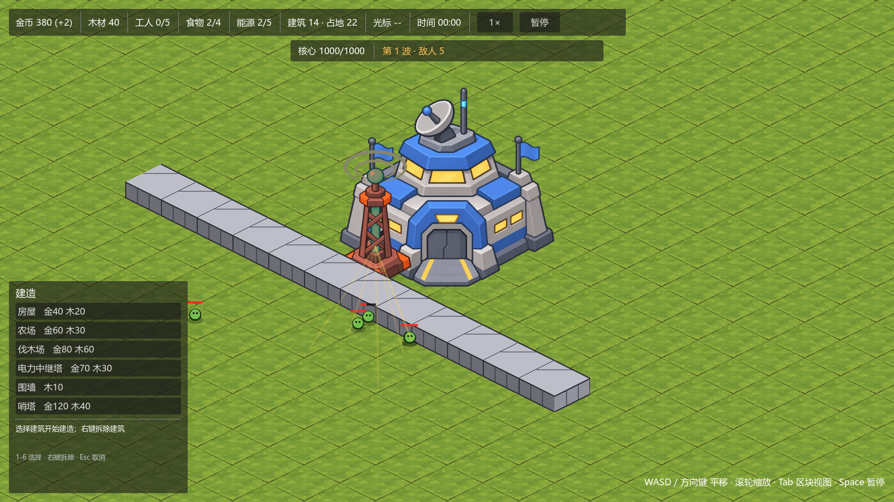

# Billions Mech｜区域指挥型生存 RTS

以《亿万僵尸》式基地经济为起点、后续叠加区块指挥视图的 2D 等距 RTS 原型。



- 设计文档：[区域指挥型生存RTS_设计文档_v0.2.md](区域指挥型生存RTS_设计文档_v0.2.md)
- 开发指南：[区域指挥生存RTS_基础开发指南_v0.1.md](区域指挥生存RTS_基础开发指南_v0.1.md)
- 当前阶段：**M1 经济与建设、M2 区块视图、威胁与防守切片均已完成**，下一步做波次/平衡打磨。

## 环境

| 项 | 值 |
|---|---|
| 引擎 | Godot 4.7.2 stable（Steam 版，`godot` 命令已在 PATH） |
| 语言 | GDScript |
| 渲染 | GL Compatibility |
| 视口 | 1600 × 900，`canvas_items` 缩放 |
| 地图 | 32 × 32 逻辑格，等距菱形 128 × 64 |
| 经济 tick | 1.0 游戏秒（`GameState.economy_tick_seconds`） |

运行：双击 [run.bat](run.bat)，或命令行：

```powershell
godot --path .                      # 运行主场景
godot --headless --path . --import  # 只导入资源
godot --headless --path . --quit-after 90   # 冒烟校验（无渲染）
```

## 操作

| 操作 | 效果 |
|---|---|
| `WASD` / 方向键 | 平移镜头 |
| 鼠标滚轮 | 缩放（0.45×–3×） |
| `1`–`6` 或点击建造菜单 | 选择房屋 / 农场 / 伐木场 / 电力中继塔 / 围墙 / 哨塔 |
| 顶部威胁条 | 核心生命、下一波倒计时、存活敌人 |
| 左键 | 放置（保持选中，可连续建造） |
| 右键 / `Esc` | 取消当前建造 |
| 右键（未选建筑时） | 拆除光标下建筑，不返还资源 |
| `Space` | 暂停 / 继续 |
| 速度按钮 | `1× → 0.5× → 0.25×` 循环，只降速不加速 |
| 悬停建筑 | 右侧显示名称、说明、占地、成本、产出与容量 |
| 选择建筑时 | 地图上显示可建造范围；取消建造后隐藏 |
| `Tab` | 切换实体视图 / 区块视图 |
| 区块视图左键 | 选中区块并显示统计；右键/Esc 取消选中 |
| `R`（失败后） | 重新开始本局 |

## 建筑

| 建筑 | 占地 | 成本 | 生命 | 效果 |
|---|---|---|---|---|
| 指挥中心 | 3×3 | 开局自动放置 | 1000 | +5 工人、+4 食物、+5 能源、+2 金币/tick、建造范围 6；不可拆除、唯一、核心 |
| 房屋 | 1×1 | 金 40 / 木 20 | 150 | +4 工人容量、+2 金币/tick；食物 2、能源 1 |
| 农场 | 2×2 | 金 60 / 木 30 | 200 | +10 食物供给；占 2 工人、能源 1 |
| 伐木场 | 2×2 | 金 80 / 木 60 | 250 | +3 木材/tick；占 2 工人、食物 1、能源 1、维护 1 金 |
| 电力中继塔 | 1×1 | 金 70 / 木 30 | 150 | +10 能源供给、建造范围 6；维护 1 金 |
| 围墙 | 1×1 | 木 10 | 400 | 阻挡敌人，吸收伤害；无经济 |
| 哨塔 | 1×1 | 金 120 / 木 40 | 250 | 攻击 12 / 0.8 秒、射程 5 格；能源 1 |

初始资源：金币 500、木材 200。

## 经济与时间

1. **tick 固定 1 游戏秒。** `SimulationClock` 累加 `delta × speed`，每满 `tick_seconds` 发一次 `tick`；
   `EconomySystem` 在 `GameState` 的 tick 回调里统一结算所有建筑的产出与维护费。
2. **暂停时 `_process` 直接返回**，不结算；继续后从暂停处恢复。
3. **只提供慢速档位**：`1× / 0.5× / 0.25×`。0.5× 时每 2 秒现实时间结算 1 个游戏秒；不提供加速档。
4. 单帧最多补算 5 个 tick，断点/拖窗口后不会一次性刷资源。
5. **库存与容量分开**：金币/木材是库存；工人/食物/能源是“占用/供给”容量。
6. **建造前置校验按“建成后”的总量判断**，包含新建筑自身的供给：
   ```text
   workers_used + new.required <= workers_total + new.housing
   food_demand + new.food_demand <= food_supply + new.food_capacity
   energy_demand + new.energy_demand <= energy_supply + new.energy_supply
   ```
7. 拆除不返还资源；拆除后全量重算容量、收支与建造覆盖；指挥中心不可拆除。

## 建造范围（M1-05）

- 覆盖范围 = 所有 `build_range_radius > 0` 的建筑，以其**占地每一格**为圆心、欧氏半径内的并集。
  - 指挥中心：半径 6，开局 169 格覆盖。
  - 电力中继塔：半径 6，可在现有覆盖内向外延伸（实测 169 → 221 格）。
- **放置规则要求 footprint 的每一格都在覆盖内**；范围外提示“超出建造范围”。
- 初始建筑通过 `place_initial_building()` 跳过范围检查（此时还没有任何覆盖），其余校验一致。
- 覆盖在建造/拆除后重算；中继塔被拆除后，其扩展区域立即收回。
- 覆盖层**只在选择建造时显示**：`World/BuildRangeOverlay` 绘制 8% 绿色填充 + 边界描边，
  只读 `BuildingSystem.build_coverage`；取消建造/按 Esc 后立即隐藏。

## 区块视图（M2）

- 32×32 地图按 8×8 逻辑格划分为 4×4 = 16 个区块，编号 A1–D4。
  > 这是开发指南的口径；设计文档里的“9–12 块”留作后续可调项，目前不改。
- `Tab` 切换 A 实体视图 / B 区块视图；相机位置、缩放、游戏时间、资源与建筑状态完全不变。
- B 视图绘制区块填充、边界、区块编号与建筑数量；选中区块黄色高亮，悬停白色描边。
- 点击区块后，右侧面板显示：
  - 建筑数量与类型（按建筑锚点 `origin_cell` 归属，跨区块建筑只计一次）；
  - 占地格数（按每个被占用格子实际所属区块统计，跨区块建筑会分摊到多个区块）；
  - 可建空地（未占用且地形可建）；
  - 产出与维护（只汇总锚点属于该区块的建筑定义）。
- B 视图只读：隐藏建造菜单、关闭建造输入与格子高亮；不暂停、不改变任何经济或建筑状态。
- 统计在建造/拆除后通过 `buildings_changed` 即时刷新；区块本身不产生任何资源。

## 威胁与防守切片

- 第一波在 40 游戏秒后出现（6 名），之后每 50 秒一波，每波 +3；倒计时显示在顶部威胁条。
- 敌人从地图下边缘三处出生，直线逼近核心。**没有寻路**：遇到第一座建筑就停下攻击，
  因此围墙能挡住它们；这是刻意的切片简化。
- 核心 1000 HP；被摧毁 → 暂停时钟、显示“基地失守”，按 `R` 或按钮重开。
- 哨塔自动攻击射程 5 格内最近敌人（12 伤害 / 0.8 秒），有短暂射击光线；围墙 400 HP。
- 暂停/慢速同步作用于波次、敌人移动和战斗；区块视图不暂停战斗。
- 当前简化：敌人是灰盒圆点、无绕行/多路径、建筑没有血条与修复、波次奖励未做。

## 目录结构

```text
res://
  run.bat
  project.godot
  scenes/
    main.tscn                 # GameState + World + Camera2D + HUD + 控制器
    world.tscn                # Ground/覆盖层/建筑/敌人/特效
    ui/hud.tscn               # 资源栏、建造菜单、威胁条、信息/区块面板、失败界面
    world/build_preview.tscn
    buildings/building_view.tscn
    units/enemy_view.tscn
  scripts/
    main.gd
    core/                     # game_state / grid_state / simulation_clock
    economy/economy_system.gd
    buildings/                # definition / instance / system / view
    combat/                   # enemy_state / enemy_view / threat_system
    input/                    # build_controller / region_view_controller
    ui/                       # hud / resource_panel / build_palette /
                              # building_info_panel / region_panel / threat_panel
    world/                    # world / cell_highlight / camera_controller /
                              # build_preview / build_range_overlay /
                              # region_overlay / combat_effects
    regions/region_system.gd  # 区块划分 + 只读统计聚合
  data/buildings/
    command_center.tres       # 3×3，初始核心，范围 6
    house.tres                # 1×1
    farm.tres                 # 2×2
    lumberyard.tres           # 2×2
    power_tower.tres          # 1×1，能源 + 扩建
    wall.tres                 # 1×1，400 HP 阻挡
    guard_tower.tres          # 1×1，哨塔
  tiles/terrain_tileset.tres
  art/placeholder/
    iso_ground.png
    buildings/{command_center,house,farm,lumberyard,power_tower,wall}.png
  docs/screenshots/
  ui/fonts/system_cjk_font.tres
  临时素材/
```

## 架构约定

```text
GameState（唯一真实状态）
├── SimulationClock   固定 tick、暂停、慢速
├── GridState         逻辑格、占地、地形阻挡
├── EconomySystem     库存 + 容量 + 每 tick 收支
├── BuildingSystem    定义、实例、校验、建造/拆除、建造覆盖、伤害
├── RegionSystem      区块划分 + 只读统计
└── ThreatSystem      波次、敌人、核心生命、防御塔

视图层：World / Camera2D / HUD / BuildController
  只读 GameState，接收信号；输入只调用 BuildingSystem 的公开接口
```

必须遵守：

1. **二维逻辑网格是唯一空间真相。** 占地只看 `origin_cell + footprint`，不看贴图尺寸。
2. **数据先于表现。** 先写 `GridState` / `instances` 并发信号，`World` 才创建/销毁 `BuildingView`。
3. **统一命令入口。** 手动建造与未来规划层都调用 `try_place_building()` / `remove_building()`；
   预览调用只读的 `get_placement_error()`，共用同一套规则。
4. **经济按模拟时间结算。** 收益只从 `SimulationClock.tick` 进入 `EconomySystem.process_tick()`。
5. **容量与库存分开。** 金/木是库存；工人/食物/能源是供给与占用。
6. **区块不产生经济。** M2 的统计必须从建筑实例聚合。

## 等距坐标与建筑锚点

- `TileSet`：**Isometric / 128×64 / `tile_layout = 5`**。默认 stacked 会得到横向条带坐标，必须显式设为 5。
- `map_to_local()` 返回格中心；32×32 地图世界范围约 `(-1984, -32) ~ (2112, 2080)`。
- 建筑占地块的前角（最下方顶点）：
  ```text
  anchor = cell_to_world(origin + footprint - 1) + (0, 32)
  ```
  贴图以底边中点对齐 anchor，节点 y 用于 Y 排序。
- 预览占地菱形：bottom `(0,0)`、right `(sy*64, -sy*32)`、top `((sy-sx)*64, -(sx+sy)*32)`、
  left `(-sx*64, -sx*32)`。

## 美术管线

`临时素材/*.png`（1254×1254，透明背景）→ 裁切 alpha 包围盒 → 按占地底宽缩放：

| 资产 | 底宽对应 | 游戏内尺寸 |
|---|---|---|
| 地块 | 1 格 | 128×64 |
| 房屋 | 1 格 | 145×148 |
| 伐木场 | 2 格 | 262×237 |
| 农场 | 2 格 | 256×192 |
| 电力中继塔 | 1 格 | 128×245 |
| 指挥中心 | 3 格 | 384×357 |

## 新增建筑

在 `data/buildings/` 新建 `BuildingDefinition` 资源，必填 `building_id`、`display_name`、`footprint`、`texture`：

- 菜单与规则：`buildable`、`unique`、`demolishable`、`palette_order`
- 成本与收支：`build_cost`、`upkeep_per_tick`、`output_per_tick`
- 容量：`housing_capacity`、`required_workers`、`food_capacity`、`food_demand`、
  `energy_supply`、`energy_demand`
- 范围：`build_range_radius`
- 战斗：`max_hp`、`is_core`、`attack_range`、`attack_damage`、`attack_interval`
- 视觉：`sprite_scale`、`sprite_offset`、`sprite_modulate`

`BuildingSystem` 启动时扫描该目录；建造菜单与 `1–4` 热键只列出 `buildable = true` 的定义。

## 已完成 / 下一步

M1-01（已完成）：项目骨架、GameState、场景、输入、Git。

M1-02（已完成）：等距 TileSet、32×32 地面、镜头平移/缩放/边界、悬停高亮与坐标。

M1-03（已完成）：建筑放置、预览、拆除、边界/重叠校验、Y 排序。

M1-04（已完成）：指挥中心、五类建筑、资源与容量 UI、每 tick 收支、容量校验、拆除回退。

M1-05（已完成）：

- [x] 指挥中心初始覆盖范围（半径 6）
- [x] 电力中继塔扩大覆盖（实测 169 → 221 格）
- [x] 选择建造时显示半透明覆盖层与边界，取消后隐藏
- [x] 范围外禁止建造；中继塔拆除后范围收回
- [x] 建筑信息面板（名称、说明、占地、成本、产出、容量）
- [x] 暂停；慢速 0.5× / 0.25×，只降速不加速
- [x] 实测：0.5× 下 1 秒不结算、2 秒结算 1 次；1× 下 1 秒结算 1 次

M1-06（已完成，稳定性回归）：

- [x] 1×1 连续建造/拆除 100 次：0 失败，占地与实例数回到基线
- [x] 2×2 连续建造/拆除 50 次：4 格全部释放，无幽灵占地
- [x] 地图边缘：2×2 在 (31,31) 报越界；在 (30,30) 报范围外
- [x] 100 座建筑：实例 101、占地 109，与 `GameState` 统计一致
- [x] 暂停 10 秒 0 次结算；恢复 3 秒 3 次；暂停/恢复反复切换无重复结算
- [x] 0.5× 下 2 秒结算 1 次；建造范围覆盖层仅建造模式显示
- [ ] JSON 存档（非 M1 门槛，推迟到 M2 之后）

M1 验收：固定 32×32 等距地图上具备完整建设循环 —— 开局指挥中心、范围内建造、
资源与容量约束、周期产出、慢速与暂停、建筑信息与建造范围展示。

M2（已完成）区块视图：

- [x] `RegionId` 与 8×8 固定区块映射（4×4 = 16 块，A1–D4）
- [x] 区块边界/编号/建筑数量覆盖层，选中黄色、悬停白色
- [x] `Tab` 切换 A/B，相机中心、缩放、时间、资源与建筑状态不变
- [x] 点击区块显示建筑数量/类型、占地、空地、产出与维护
- [x] 跨区建筑：建筑/产出按锚点计一次，占地按实际格数分摊
- [x] B 视图只读：隐藏建造菜单、禁用建造输入与格子高亮，不暂停不结算

实测：

- 指挥中心 (14,14) 跨 B2/C2/B3/C3 四个区块：占地 4/2/2/1，建筑与金币产出只计 B2。
- 伐木场 (15,17) 锚点 B3：B3 建筑 1、木材 +3；占地 B3 +2、C3 +2；总占地 13。
- B 视图：`overlay=true`、`palette=false`、`build_input=false`，camera/clock 不变。
- 切回 A：`overlay=false`、`palette=true`、`build_input=true`，camera/clock/resources/instances 不变。

M2 验收：A 建造后 B 立即看到正确统计；B 选中区块再切回 A，世界状态完全不变；
区块边界与逻辑格对齐；统计只读，不产生经济。

威胁与防守切片（新原型方向，已完成）：

- [x] 第一波 40 秒倒计时、6 名敌人；之后每 50 秒一波、每波 +3
- [x] 敌人从地图下边缘直线接近核心，遇到建筑停下攻击
- [x] 核心 1000 HP；被毁即失败，失败覆盖层支持 `R` 或按钮重开
- [x] 围墙 400 HP 阻挡；哨塔 12 伤害 / 0.8 秒、射程 5 格
- [x] HUD 威胁条：核心生命 / 波次倒计时 / 存活敌人
- [x] 暂停与慢速同步作用于波次、移动和战斗；区块视图不暂停战斗

实测：

- 1 哨塔 + 12 围墙：第一波 30 秒内清空，核心 1000，哨塔共射击 24 次。
- 仅 12 围墙：30 秒核心无损；120 秒后 4 段墙被拆、核心降至 484。
- 无防御第二波：90 秒后核心 0，`defeated=true`，失败覆盖层显示。

下一步：波次/数值平衡、敌人出生提示与简单绕行、建筑受伤反馈、JSON 存档。

## 约定

- 脚本用 **Tab** 缩进；类名与文件名一致。
- 节点/资源 ID 用 `StringName`；资源键用 `String`（`"gold"`、`"wood"`）。
- 不写测试脚本；改动用 `godot --headless --path . --quit-after 90` 验证无报错。
- 提交前确认 `git status` 不含 `.godot/`。
